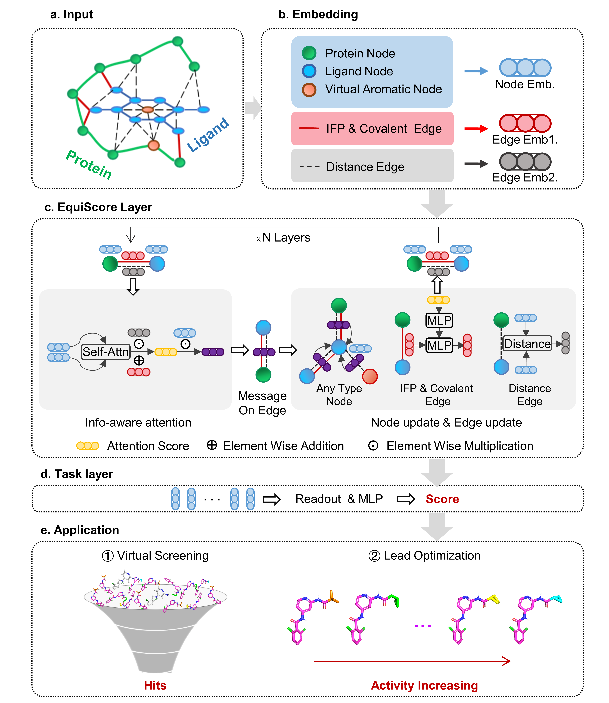

# EquiScore is a generic protein-ligand interaction scoring method integrating physical prior knowledge with data augmentation modeling

### [Paper on BioRXiv](https://www.biorxiv.org/content/10.1101/2023.06.18.545464v2)

Implementation of EquiScore, by Duanhua Cao 😊.

### 🔔 News

   Some bugs(🐛 🐛) have been fixed, and bash commands are further provided to help users unfamiliar with python quickly use EquiScore for virtual screening 😃

**This repository contains all code, instructions and model weights necessary to **screen compounds** by EquiScore, eval EquiScore or to retrain a new model.**

If you have any question, feel free to open an issue or reach out to us: [caodh@zju.edu.cn ✉️](caodh@zju.edu.cn).

## Framework



## Dataset

If you want to train one of our models with the PDBscreen data you should do:

1. download Preprocessed PDBscreen data from [zenodo](https://doi.org/10.5281/zenodo.8049380)
2. uncompress the directory by tar command and place it into `data` such that you have the path `/EquiScore/data/training_data/PDBscreen`
3. see retraining EquiScore part for details.

## Setup Environment

We recommend setting up the environment using [Anaconda](https://docs.anaconda.com/anaconda/install/index.html).

   Clone the current repo

   git clone git@github.com:CAODH/EquiScore.git

This is an example for how to set up a working conda environment to run the code (but make sure to use the correct pytorch, DGL, cuda versions or cpu only versions):

   `conda create --name EquiScore python=3.8`
   `conda activate EquiScore`

   **Through our testing, the relevant environment can be successfully installed by executing the following commands in sequence:**

   `conda install pytorch==1.11.0 cudatoolkit=11.3 -c pytorch`

   `conda install -c dglteam dgl-cuda11.1`

   `conda install -c conda-forge rdkit`

   `conda install -c conda-forge biopython`

   `conda install -c conda-forge scikit-learn`

   `conda install -c conda-forge prolif`

   `pip install prefetch-generator`

   `pip install lmdb`

   `pip install numpy==1.22.3`

**or you can download the conda-packed file [zenodo](https://zenodo.org/records/10417452), and then unzip it in ${anaconda install dir}/anaconda3/envs/EquiScore. ${anaconda install dir} represents the dir where the anaconda is installed. For me, ${anaconda install dir}=/root.**

   `mkdir ${anaconda install dir}/anaconda3/envs/EquiScore `

   `tar -xzvf EquiScore.tar.gz -C ${anaconda install dir}/anaconda3/envs/EquiScore`

   `conda activate EquiScore`

   **after enter the EquiScore env: run**

   `conda-unpack`

## **Using the provided model weights to screen a compound for your target protein**

   We implemented a Screening.py python script, to help **anyone want to screen Hits from a compound library**.

   We provide a toy example under the ./data/sample_data folder for illustration.

### **🚀just some steps needed**

1. Docking compounds with target protein to get docking pose, EquiScore is robust to pose sources and you can choose any method you are familiar with to generate poses(**Glide,Vina,Surflex,Gold,LeDock**), or you can try a **deep learning method**.
2. Assume that you have obtained the results of the docking in the previous step. Then, get pocket region and compound pose.
   run script:

   `python ./get_pocket/get_pocket.py --docking_result ./data/sample_data/sample_compounds.sdf --recptor_pdb ./data/sample_data/sample_protein.pdb --single_sdf_save_path ./data/sample_data/tmp_sdfs --pocket_save_dir ./data/sample_data/tmp_pockets`

   or use bash command script in bash_scripts dir: You just need to replace the corresponding parameters

   `cd ~/EquiScore/bash_scripts`
   `bash Getpocket.sh`
3. Then, you have all data to predict protein-ligand interaction by EquiScore! Be patient. This is the last step!

   `python Screening.py --ngpu 1 --test --test_path ./data/sample_data/ --test_name tmp_pockets --pred_save_path  ./data/test_results/EquiScore_pred_for_tmp_pockets.csv`

   or use bash command script in bash_scripts dir: You just need to replace the corresponding parameter

   `cd ~/EquiScore/bash_scripts`
   `bash Screening.sh`
4. Until now, you get all prediction result in pred_save_path!

## **Using the provided model weights for evaluation and Reproduces the benchmark result**

   Just like screen compounds for a target, benchmark dataset have many targets for screening, so we implemented a script to calculate the results

### **just some steps needed**

1. We provided Preprocessed pockets on zenodo (download pockets from [zenodo](https://doi.org/10.5281/zenodo.8047224)). IF YOU WANT GET RAW DATASET PLEASE DOWNLOAD RAW DATA FROM REFERENCE PAPERS.
2. you need to download the Preprocessed dataset and extract data to ./data/external_test_data.(for example, all pockets in DEKOIS2.0 docking by Glide SP should be extract into one dir like ./data/external_test_data/dekois2_pocket)
3. if you want to preprocessed data to get pocket , all pocket file names should contain '_active' for active ligand,'_decoy' for decoys and  all pockets in a dir for one benchmark dataset
4. run script (You can use the nohup command and output redirects as you normally like):

   `python Independent_test.py --test --test_path ./data/external_test_data --test_name dekois2_pocket --test_mode multi_pose`

   the result will be saved in ~/EquiScore/workdir/official_weight/

   or use bash command script in bash_scripts dir: You just need to replace the corresponding parameter

   `cd ~/EquiScore/bash_scripts`
   `bash Benchmark_test.sh`

   use **multi_pose** arg if one ligand have multi pose and set pose_num and **idx_style** in args ，see args `--help for more details`

## **Retraining EquiScore 🤖 Model**

### **Retraining EquiScore or fine tune your model is also very simple!**

1. you need to download the traing dataset , and extract pocket data to ./data/training_data/PDBscreen
   (You can also use your own private data, As long as it can fit to EquiScore after processing)
2. use uniprot id to deduplicated data and split data in `./data/data_splits/screen_model/data_split_for_training.py`
   in this script, will help deduplicated dataset by uniprot id and split train/val data and save data path into a pkl file (like "train_keys.pkl, val_keys.pkl, test_keys.pkl").
3. run train.py script:

   `python Train.py --ngpu 1 --train_keys your_keys_path --val_keys your_keys_path --test_keys your_keys_path --test`

   or use bash command script in bash_scripts dir: You just need to replace the corresponding parameter

   `cd ~/EquiScore/bash_scripts`
   `bash Training.sh`

   (**In the first round of training, data is processed and saved, so it may be slower, depending on hardware conditions OR If you wish to expedite the training process, please refer to the preprocessing workflow in dataset.py, save the data to the LMDB database, and then specify the LMDB path in the training script by adding --lmdb_cache lmdb_cache_path to replace --test like we did in bash command** )

## 📂 Codebase Structure

### Core Models & Inference
- `model/equiscore.py` – Main EquiScore architecture (graph neural network backbone)
- `model/equiscore_layer.py` – Custom equivariant GNN layers
- `Train.py` – Model training pipeline
- `Screening.py` – Single and batch screening inference
- `Independent_test.py` – Benchmark evaluation

### Development Workflow (Scoring Pipeline)
- `workflow/scripts/score_methods.py` – Multi-method scoring system (7 methods):
  - **Ligand-only** (3): `lambdamart_ligand`, `logistic_regression_ligand`, `tanimoto_random_ref`
  - **Assay-augmented** (2): `lambdamart_ligand_assay`, `logistic_regression_ligand_assay` (standard_value_filled only, no metadata one-hots)
  - **Fingerprint-based** (2): `lambdamart_fingerprint`, `logistic_regression_fingerprint`
- `workflow/scripts/evaluate_predictions.py` – Metric computation (median-only aggregation: EF@%, NEF@%, NDCG@%, MAP, ERR, ROC-AUC, BEDROC_a20, EFB@1%, EFB_max)
- `workflow/scripts/compare_sna_summaries.py` – SNA-stratified result comparison (tidy format)
- `workflow/scripts/combine_dataset_intermediates.py` – Multi-dataset consolidation
- `workflow/scripts/combine_dataset_summaries.py` – Cross-dataset summary merging
- `Snakefile` – Workflow orchestration

### Data & Features
- `dataset/dataset.py` – Data loading and preprocessing
- `data/`:
  - `sample_data/` – Example molecules and proteins for testing
  - `data_splits/` – Train/val/test split definitions
  - `manifests/` – Precomputed parquet manifests (features, descriptors, assay data)
- `utils/dataset_utils.py` – Dataset sampling and filtering
- `utils/features.py` – Molecular descriptors (TPSA, MW, rotatable bonds, HBA/HBD, ring counts, compliance)
- `utils/equiscore_utils.py`, `utils/ifp_construct.py`, `utils/loss_utils.py` – EquiScore utilities

### Analysis & Visualization
- `visualization/eda_bigbind.py` – Marimo EDA: BigBind exploration (train+val, full SNA)
  - Dataset overview, descriptor distributions, feature completeness, assay metadata, SNA breakdown
  - Interactive protein filter
- `visualization/eda_pdbscreen.py` – Marimo EDA: PDBScreen exploration (train+val)
  - Parallel structure to BigBind; no assay metadata
- `visualization/eda_comparison.py` – Marimo EDA: BigBind vs PDBScreen comparison
  - Size/composition, ligand property overlays, target overlap, class balance analysis
- `visualization/` – Additional exploratory notebooks

### Configuration & Documentation
- `config.yaml` – Method list, hyperparameters, data paths, evaluation config
- `requirements-manifest.txt` – Python dependencies
- `AGENTS.md` – AI agent collaboration guidelines (see below)

### Results & Artifacts
- `PDBscreen/` – 7 PDBScreen variants (HQ/LQ, active/decoy poses)
- `results/` – Model weights and baseline rankings
- `workdir/` – Intermediate outputs and model artifacts

---

## 📊 Output Schemas

### Prediction Output (Long Format)
```
protein_id | ligand_smiles | label | method | score | rank_within_protein | sna
```
One row per (protein, ligand, method) triplet; `rank_within_protein` = ligand's rank by descending score within protein.

### Summary Metrics (Method-Level Aggregation)
Median-only columns (no means):
- `method`, `ef@1%_median`, `ef@5%_median`, `ef@10%_median`
- `efb@1%_median`, `efb_max_median`
- `nef@1%_median`, `nef@5%_median`, `nef@10%_median`
- `ndcg@1%_median`, `ndcg@5%_median`, `ndcg@10%_median`
- `map_median`, `err_median`, `roc_auc_median`, `bedroc_a20_median`
- `n_queries`, `total_ligands`, `total_actives`, `total_inactives`

### SNA Comparison (Tidy Format)
Leading columns: `method`, `dataset_name`, `sna` (one row per method × dataset × SNA combination)

---

## 🎯 Key Design Decisions

1. **Multi-method baselines** – Ligand-only → +assay → fingerprint-only for systematic ablation
2. **Assay leakage mitigation** – Only `standard_value_filled` used (no standard_type one-hots or missingness flags)
3. **Median-only metrics** – Robust aggregation; eliminates noisy mean metrics
4. **Tidy output schema** – Explicit `sna` column; method/dataset/sna leading columns
5. **Train+val focus in EDA** – Test sets held out for final validation
6. **Fingerprint baselines** – ECFP (radius=2, 2048 bits) for transparent ML comparison

---

## 🚀 Quick Start

### Score with Multi-Method Pipeline
```bash
python workflow/scripts/score_methods.py \
  --manifest dataset/bigbind_manifest.parquet \
  --methods all \
  --sna all \
  --out results/predictions.parquet
```

### Evaluate Predictions
```bash
python workflow/scripts/evaluate_predictions.py \
  --predictions results/predictions.parquet \
  --summary-out results/summary.parquet \
  --by-query-out results/by_query.parquet
```

### Explore Data
```bash
marimo run visualization/eda_bigbind.py
marimo run visualization/eda_pdbscreen.py
marimo run visualization/eda_comparison.py
```

---

## 📚 Feature Reference

### Ligand Descriptors (All Methods)
Computed in `utils/features.py`:
- `tpsa`, `molecular_weight`, `rotatable_bonds`, `ring_count`, `aromatic_ring_count`, `hbd`, `hba`
- `lipinski_compliant`, `verber_compliant`

### Fingerprints
- `ligand_fingerprint` – 2048-bit Morgan fingerprint (radius=2) from ligand_smiles

### Assay Data (BigBind)
- `standard_type` – Assay type (IC50, Ki, Kd, etc.)
- `standard_value` – Binding affinity value
- `standard_value_filled` – Median-imputed from training set (used by assay methods)

### Data Variants (BigBind)
- `sna` – Stochastic Negative Addition flag (true/false)
- Full dataset analyzed in EDA; assay methods show high performance (⚠️ likely leakage)

---

## Citation

   Cao D, Chen G, Jiang J, et al. EquiScore: A generic protein-ligand interaction scoring method integrating physical prior knowledge with data augmentation modeling[J]. bioRxiv, 2023: 2023.06. 18.545464.
   doi: https://doi.org/10.1101/2023.06.18.545464

## License

MIT
